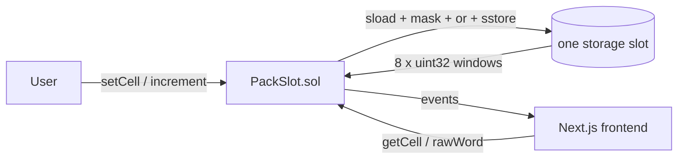

# PackSlot — 8 numbers living in a single storage slot

> A Yul/inline-assembly demo: bit-packing eight `uint32` cells into one 256-bit
> word, with hand-rolled overflow checks, manual reverts and `extcodesize`
> detection.


-success)


🔗 **Live demo:** _(Netlify URL pending deploy)_
📜 **PackSlot:** `0x…` (Sepolia, verified — pending deploy)

---

## What it does

- Stores **8 numbers in one storage slot** instead of eight, by packing each into
  a 32-bit window of a single `uint256`.
- Lets the owner **set, read and increment** any of the 8 cells individually.
- Adds **hand-written overflow checks** in assembly (Solidity 0.8's checks are
  bypassed inside `assembly {}`, so they're rebuilt here).
- Shows **`extcodesize`** — the same primitive behind OpenZeppelin's
  `Address.isContract()` — with no interface needed.

## Why assembly here

Solidity charges ~20,000 gas for the first write to a fresh slot. Eight separate
`uint32` variables = eight slots. Packing them into one = one slot. The contract
demonstrates the read-modify-write dance that makes this safe: **clear the target
32-bit window, OR in the new value, `sstore` once**.

```solidity
function setCell(uint8 index, uint32 value) external onlyOwner {
    assembly {
        let shift := mul(index, 32)
        let slot := sload(s_packed.slot)
        let cleared := and(slot, not(shl(shift, 0xffffffff)))
        sstore(s_packed.slot, or(cleared, shl(shift, value)))
    }
}
```

## How it works



## Tech stack

| Layer | Tech |
|-------|------|
| Smart contract | Solidity 0.8.26 + inline assembly (Yul) |
| Dev / testing | Foundry (forge) |
| Frontend | Next.js 15 + wagmi v2 + viem + RainbowKit |
| Network | Ethereum Sepolia testnet |

## Testing

```bash
forge test
```

`12 tests, 1000 fuzz runs`:

- ✅ Set / read each cell, cells stay independent, raw word updates
- ✅ Increment with an exact-sum **fuzz test** (1000 runs, never wraps)
- ✅ **Overflow revert** when an increment would exceed 32 bits
- ✅ Zero-delta, bad-index (index 8), non-owner and paused-write reverts
- ✅ `extcodesize` detects contracts vs EOAs
- ✅ `reset()` wipes all 8 cells with a single `sstore(0)`

## Run locally

```bash
git submodule update --init --recursive
forge test -vv

cd frontend && npm ci && npm run dev
```

## What I learned

- Assembly **silently wraps** on overflow; Solidity's checks are a feature you
  have to rebuild by hand inside `assembly {}` — and the check must match the
  *cell width* (32 bits here), not the word width.
- Bit-packing is the reason gas golfing and storage layout matter: the same
  eight numbers cost 1 slot or 8 depending on how they're laid out.

---

**Armando Ochoa** · Smart Contract Developer
Part of a 25+ block blockchain accelerator — this is the inline-assembly (Yul)
module (Block 25).
